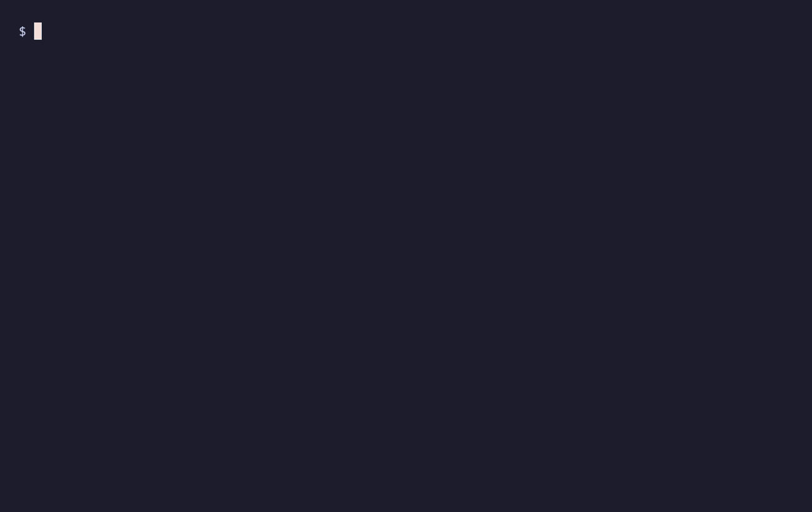
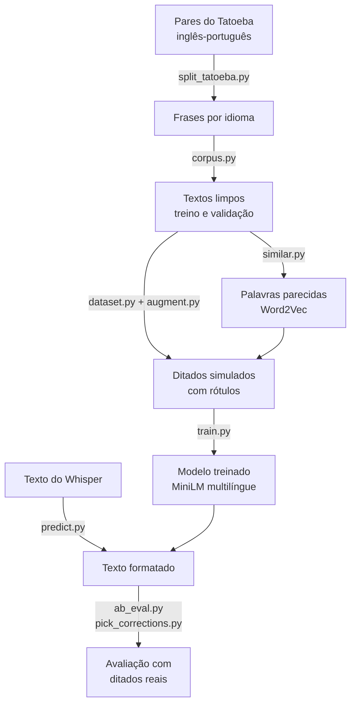

# Formatter: formatador de ditado

Um modelo pequeno, que roda em CPU, para limpar o texto que o Whisper transcreve de um ditado. Ele
apaga hesitações, recomeços e correções, e coloca vírgulas, pontos, interrogações e maiúsculas. Foi
feito para o [DronsioFlow](https://github.com/guihassen/DronsioFlow), um app de ditado por voz
100% local para Linux, e funciona em **português e inglês**.

```text
Whisper:      ahn eu vou eu vou comprar leite digo vou comprar pão na quarta você vem comigo
Formatador:   Eu vou comprar pão na quarta. Você vem comigo?
```



O modelo foi construído à mão, etapa por etapa, como projeto de estudo de Machine Learning. Formata
um ditado de 60 palavras em cerca de 30 a 50 ms numa CPU de notebook.

---

## A ideia: uma etiqueta por palavra

Em vez de reescrever o texto (como um LLM faria), o modelo só **classifica cada palavra** com um de
5 rótulos. Isso o deixa pequeno, rápido e incapaz de inventar palavras:

| Rótulo | Significado | Exemplo |
|---|---|---|
| `KEEP_NONE` | mantém a palavra, sem pontuação | `vou` |
| `KEEP_COMMA` | mantém e coloca vírgula depois | `então,` |
| `KEEP_PERIOD` | mantém e coloca ponto depois | `quarta.` |
| `KEEP_QUESTION` | mantém e coloca interrogação depois | `comigo?` |
| `DELETE` | apaga a palavra | `ahn` |

Como não existe um conjunto grande de ditados com essas etiquetas, os dados de treino são **gerados**:
pegamos frases bem escritas e inserimos nelas os erros típicos da fala. Como fomos nós que inserimos
os erros, sabemos exatamente o rótulo certo de cada palavra.

---

## O fluxo completo



Abaixo, cada etapa com um exemplo real: as saídas foram geradas rodando o código do repositório.
As frases são inventadas para os exemplos.

### 1. Dividir os pares do Tatoeba (`split_tatoeba.py`)

O [Tatoeba](https://tatoeba.org) entrega pares de traduções num arquivo só. Separamos uma frase por
linha, para cada idioma, sem repetir frases:

```text
Entrada:  1276 <tab> Let's try something. <tab> 180624 <tab> Vamos tentar alguma coisa!

Saída:    eng_sentences.tsv →  1276   <tab> eng <tab> Let's try something.
          por_sentences.tsv →  180624 <tab> por <tab> Vamos tentar alguma coisa!
```

Resultado: 281.344 frases em português e 242.873 em inglês.

### 2. Limpar e agrupar as frases (`corpus.py`)

Cada frase é normalizada, e as que o modelo não consegue representar são descartadas:

```text
"Você vai à reunião amanhã?!"  →  "Você vai à reunião amanhã?"     (?! vira ?)
"Eu   comprei pão!"            →  "Eu comprei pão."                (! vira ., espaços somem)
'Ele disse: "oi".'             →  descartada                       (tem : e aspas)
"Oi."                          →  descartada                       (curta demais)
```

Depois, 5% das frases vão para a validação, e as frases seguidas são juntas em textos de 1 a 6
frases, para parecerem um ditado:

```text
["Vou comprar pão.", "Você vem comigo?", "A reunião é na quarta.", "Depois eu te ligo."]
        ↓
["Vou comprar pão. Você vem comigo?",  "A reunião é na quarta. Depois eu te ligo."]
```

### 3. Aprender palavras parecidas (`similar.py`)

Um Word2Vec treinado nos textos encontra palavras que aparecem em contextos parecidos. Elas servem
para simular correções realistas ("terça, não, quarta"):

```text
quarta   →  sexta, quinta, segunda, sexta-feira, conferência
comprar  →  vender, contratar, alugar, reservar, vestir
reunião  →  escola, festa, praia, igreja, corrida
manhã    →  noite, tarde, meia-noite
```

### 4. Separar palavras e etiquetas (`tags.py`)

O texto limpo vira três listas paralelas: as palavras, a ação (`KEEP`/`DELETE`) e a pontuação depois
de cada palavra. A volta (`apply_tags`) remonta exatamente o mesmo texto:

```text
"Vou comprar pão na quarta. Você vem comigo?"
        ↓ extract_tags
tokens:  vou   comprar  pão   na    quarta  você  vem   comigo
actions: KEEP  KEEP     KEEP  KEEP  KEEP    KEEP  KEEP  KEEP
puncts:  NONE  NONE     NONE  NONE  PERIOD  NONE  NONE  QUESTION
```

### 5. Simular a fala (`augment.py`)

Aqui o texto limpo vira um "ditado", com erros inseridos. Cada palavra inserida recebe `DELETE`.
Exemplos reais gerados a partir da frase acima (entre colchetes, o que o modelo deve apagar):

| Tipo de erro | Ditado simulado |
|---|---|
| Hesitação | vou comprar [hmm] pão na quarta você [eh] vem comigo |
| Recomeço | vou comprar pão [na quarta] na quarta você vem comigo |
| Correção de palavra | vou comprar pão na [ahn] [conferência] [não] quarta você vem comigo |
| Correção de uma ideia | [vou] [comprar] [leite] [digo] vou comprar pão na quarta você vem comigo |
| Falso começo | vou comprar pão na quarta [ele] [não] você vem comigo |

E também coisas que parecem erro, mas **ficam**, para o modelo não apagar demais:

| Tipo | Texto certo (tudo fica) |
|---|---|
| Enumeração | Vou comprar pão na quarta, comprar pão na quinta. Você vem comigo? |
| "Na verdade" sem correção | Na verdade, vou comprar pão na quarta. Você vem comigo? |

### 6. Transformar em rótulos (`dataset.py`)

Ação e pontuação viram um rótulo só, e cada rótulo vira um número:

```text
tokens:  vou     comprar  leite   digo    vou        comprar    pão        na         quarta       você       vem        comigo
rótulo:  DELETE  DELETE   DELETE  DELETE  KEEP_NONE  KEEP_NONE  KEEP_NONE  KEEP_NONE  KEEP_PERIOD  KEEP_NONE  KEEP_NONE  KEEP_QUESTION
número:  4       4        4       4       0          0          0          0          2            0          0          3
```

São gerados 135 mil exemplos de treino e 7 mil de validação (`tagged_train.jsonl` e
`tagged_val.jsonl`).

### 7. Quebrar em peças e alinhar (`dataset.tokenize_and_align`)

O modelo não lê palavras: lê **peças** do tokenizador. Uma palavra pode virar várias peças ("pão" →
`▁p` + `ão`). Só a primeira peça de cada palavra recebe o rótulo; as outras recebem `-100`, que o
treino ignora:

```text
peça:      <s>   ▁vou ▁comprar ▁leite ▁digo ▁vou ▁comprar ▁p  ão    ▁na ▁quarta ▁você ▁vem ▁comigo </s>
palavra:   -     0    1        2      3     4    5        6   6     7   8       9     10   11      -
rótulo:    -100  4    4        4      4     0    0        0   -100  0   2       0     0    3       -100
```

### 8. Treinar (`train.py`)

O modelo base é o [Multilingual-MiniLM-L12-H384](https://huggingface.co/microsoft/Multilingual-MiniLM-L12-H384)
(cerca de 117 milhões de pesos), com uma camada de classificação de 5 saídas por cima. O treino usa o
`Trainer` do Hugging Face, avalia a cada 500 passos e guarda a melhor versão. As métricas são:

- **F1 macro:** a média do F1 dos 5 rótulos, com os rótulos raros pesando igual aos comuns;
- **palavras reais apagadas:** a fração de palavras certas que o modelo apagou. É o erro mais grave,
  porque some algo que você disse;
- **recall de DELETE:** a fração das palavras a apagar que o modelo de fato apagou.

### 9. Formatar um ditado (`predict.py`)

Na hora de usar, o caminho é o inverso:

```text
Whisper:         "Vou comprar leite, digo, vou comprar pão na quarta! Você vem comigo?"
     ↓ normalize_whisper   (! e ... viram ., ; e : viram ,)
                 "Vou comprar leite, digo, vou comprar pão na quarta. Você vem comigo?"
     ↓ extract_tags        (só as palavras)
                 vou comprar leite digo vou comprar pão na quarta você vem comigo
     ↓ modelo              (um rótulo por palavra)
                 DELETE DELETE DELETE DELETE KEEP_NONE KEEP_NONE KEEP_NONE KEEP_NONE KEEP_PERIOD KEEP_NONE KEEP_NONE KEEP_QUESTION
     ↓ to_tags + apply_tags
Resultado:       "Vou comprar pão na quarta. Você vem comigo?"
```

O modelo só apaga uma palavra quando tem certeza (veja "Só apagar quando tiver certeza" em
Resultados). Na dúvida, a palavra fica.

Textos longos não cabem de uma vez no modelo (128 peças). Eles são divididos em **janelas que se
sobrepõem**, e cada palavra recebe o rótulo da janela em que tem pelo menos 15 palavras de contexto dos
dois lados. Para 150 palavras de 2 peças cada:

```text
janela 1: palavras   0–62   → usa os rótulos de   0–47
janela 2: palavras  33–95   → usa os rótulos de  48–80
janela 3: palavras  66–128  → usa os rótulos de  81–113
janela 4: palavras  99–149  → usa os rótulos de 114–149
```

### 10. Avaliar com ditados reais (`ab_eval.py` e `pick_corrections.py`)

A validação sintética não basta: o que importa é o ditado de verdade. Há duas ferramentas, que
leem o histórico do DronsioFlow só para leitura e guardam tudo em `data/eval/` (fora do git,
porque são ditados pessoais):

- **`ab_eval.py`, comparação cega:** mostra a saída atual do DronsioFlow e a do modelo, em ordem
  sorteada e com as diferenças em amarelo. Você escolhe a melhor sem saber qual é qual.
- **`pick_corrections.py`, correção à mão:** escolhe os trechos curtos em que o modelo está **menos
  seguro**, você corrige no arquivo e o `--score` mede o acerto palavra por palavra.

---

## Resultados

### Versão 1 (treinada)

Na validação sintética (10 mil exemplos):

| Rótulo | Precisão | Recall | F1 |
|---|---|---|---|
| KEEP_NONE | 0,992 | 0,991 | 0,992 |
| DELETE | 0,993 | 0,997 | 0,995 |
| KEEP_PERIOD | 0,948 | 0,966 | 0,957 |
| KEEP_QUESTION | 0,904 | 0,852 | 0,877 |
| KEEP_COMMA | 0,734 | 0,683 | 0,708 |

F1 macro de 0,906, e só **0,1%** das palavras reais apagadas.

Com ditados reais, o v1 acertou **88,1%** das palavras nos 20 trechos em que estava menos seguro.
Os erros mais comuns foram:

- **Não apagar recomeços que não são repetição exata,** como "the team was going, we need to leave now".
- **Apagar enumerações,** como "o preço do arroz, o preço do feijão".
- **Vírgulas.**

### Versão 2 (atual)

A segunda rodada ataca os erros que os ditados reais mostraram:

- **correções de uma ideia inteira** ("compre o bolo, na verdade não, compre a torta");
- **correções de várias palavras** ("na terça, não, na quarta");
- **falsos começos sem gatilho;**
- **enumerações e "na verdade," que devem ficar;**
- **exemplos mais longos,** de até 6 frases.

O v2 continua do v1 por uma época nos dados novos:

```bash
nice -n 19 systemd-inhibit --what=sleep:idle:handle-lid-switch \
  python -m formatter.train --init models/formatter/best --output models/formatter_v2 --epochs 1 --lr 3e-5
```

Levou cerca de 6 horas num notebook sem GPU (i5 de 12ª geração).

- O `systemd-inhibit` impede que o computador suspenda no meio.
- O `nice -n 19` dá prioridade aos outros programas, então dá para usar o PC enquanto treina.

Se o treino parar no meio, rode **o mesmo comando com `--resume`**. Ele continua do último checkpoint,
salvo a cada 500 passos.

#### v1 × v2

Os dois modelos medidos na mesma validação nova (7.103 exemplos, com os padrões da segunda rodada,
que o v1 nunca viu):

| | v1 | v2 |
|---|---|---|
| F1 macro | 0,840 | **0,921** |
| F1 de DELETE | 0,890 | **0,982** |
| F1 de KEEP_COMMA | 0,603 | **0,805** |
| F1 de KEEP_QUESTION | 0,820 | **0,876** |
| Palavras reais apagadas | 1,46% | **0,30%** |
| Recall de DELETE | 85,8% | **97,8%** |
| Exemplos 100% certos | 47,2% | **66,1%** |

Exemplos (frases simuladas):

| Ditado cru | v1 | v2 |
|---|---|---|
| compre o bolo na verdade não compre a torta e leve para a festa | Compre o não compre a torta e leve para a festa. | Compre a torta e leve para a festa. |
| a reunião vai ser na terça não na quarta às três horas | A reunião vai ser na terça, não na quarta às três horas. | A reunião vai ser na quarta às três horas. |
| o preço do arroz o preço do feijão e o preço do café subiram | O preço do arroz, o preço do feijão e o preço do café subiram. | igual ao v1 (a enumeração fica) |

#### Só apagar quando tiver certeza

Nos ditados reais, o v2 às vezes apagava **trechos que repetem a estrutura**, mas que são
conteúdo: "quando eu quero traduzir, quando eu quero falar", "uma feature nova, uma feature mais
agêntica". Apagar uma palavra real é o pior erro, porque some algo que você disse.

Por isso o `predict.py` só aceita DELETE quando a nota dele passa a do melhor KEEP_ por pelo menos
`DELETE_MARGIN` (1,0). Se não passar, a palavra fica, com a pontuação do melhor KEEP_. O limite foi
escolhido testando vários valores:

| Limite | Palavras reais apagadas (validação) | Recall de DELETE (validação) | Palavras apagadas em 96 ditados reais |
|---|---|---|---|
| 0 (sem regra) | 0,30% | 97,7% | 159 |
| **1,0** | **0,18%** | **96,7%** | **121** |
| 2,0 | 0,11% | 95,3% | 79 |
| 3,0 | 0,06% | 93,0% | 44 |

- Com 1,0, voltam quase só as palavras que deviam ficar.
- A partir de 2,0, também voltam hesitações de verdade ("eu eu", "way way").

O preço é que algumas correções com pouca certeza deixam de ser apagadas.

Nos 20 trechos corrigidos à mão, que foram escolhidos onde o **v1** estava menos seguro e corrigidos a
partir da saída dele, os dois ficam próximos: 88,1% (v1) e 85,9% (v2 com a regra). A amostra é
pequena (277 palavras) e a maior parte da diferença está nas vírgulas.

---

## Como rodar

Requer **Python 3.13**, porque o `gensim` ainda não tem versão para o 3.14.

```bash
python3.13 -m venv .venv
source .venv/bin/activate
pip install -e ".[dev]"
```

Baixe do Tatoeba os pares inglês-português e coloque o arquivo em `data/raw/`. Depois:

```bash
python -m formatter.split_tatoeba "data/raw/<arquivo de pares>.tsv"   # 1. uma frase por linha
python -m formatter.corpus                                             # 2. textos limpos
python -m formatter.similar                                            # 3. palavras parecidas
python -m formatter.dataset                                            # 4. exemplos rotulados
python -m formatter.train --epochs 3                                   # 5. treino do zero
python -m formatter.predict                                            # 6. teste no terminal
```

Avaliação com o histórico do DronsioFlow:

```bash
python -m formatter.ab_eval                    # comparação cega
python -m formatter.pick_corrections           # gera os trechos para corrigir
python -m formatter.pick_corrections --score   # mede o modelo contra as correções
```

Testes:

```bash
python -m pytest -q
```

## Estrutura

```text
formatter/
  split_tatoeba.py     divide os pares do Tatoeba em um arquivo por idioma
  corpus.py            limpa as frases e monta os textos de treino e validação
  similar.py           Word2Vec e dicionário de palavras parecidas
  tags.py              texto ⇄ (palavras, ações, pontuações)
  augment.py           simula a fala: hesitações, recomeços, correções
  dataset.py           exemplos rotulados e alinhamento com o tokenizador
  train.py             fine-tuning com o Trainer do Hugging Face
  predict.py           formata um ditado com o modelo treinado
  ab_eval.py           comparação cega com o DronsioFlow
  pick_corrections.py  trechos para correção à mão e medição
tests/                 um arquivo de testes para cada módulo
docs/                  vídeo de demonstração (demo.tape gera o demo.gif com o VHS)
model_card.md          card do modelo para o Hugging Face
data/                  dados baixados e gerados (fora do git)
models/                modelos treinados (fora do git)
```

## Limitações conhecidas

- **Perguntas sem pista no texto.** Em português, "você vem amanhã" pode ser pergunta ou afirmação.
  Na integração, vale manter o "?" que o Whisper já colocou.
- **Vírgulas** são o rótulo mais fraco, e muitas são opcionais.
- **Correções curtas com pouco contexto,** como "we should deploy on friday no wait on monday", ainda
  podem apagar a palavra errada.
- **Recomeços sem repetição de palavras,** como "the team was going we need to leave now", nem sempre
  são apagados.
- **Frases abandonadas no fim do ditado** ("... e aí, porém, não, calma") quase nunca aparecem nos
  dados de treino, então costumam ficar.
- **Não há "!", ":" nem ";".** Eles são raros nos dados e quase não aparecem nos ditados.
- **Erros do Whisper.** O modelo não troca nem corrige palavras: se o Whisper errou uma palavra, ela
  continua errada.

## Créditos

- Frases: [Tatoeba](https://tatoeba.org), licença CC BY 2.0 FR.
- Modelo base: [Microsoft Multilingual-MiniLM-L12-H384](https://huggingface.co/microsoft/Multilingual-MiniLM-L12-H384),
  licença MIT.
- Tokenizador: [XLM-RoBERTa base](https://huggingface.co/FacebookAI/xlm-roberta-base), licença MIT.
